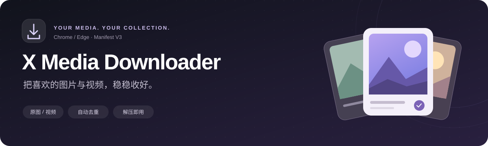
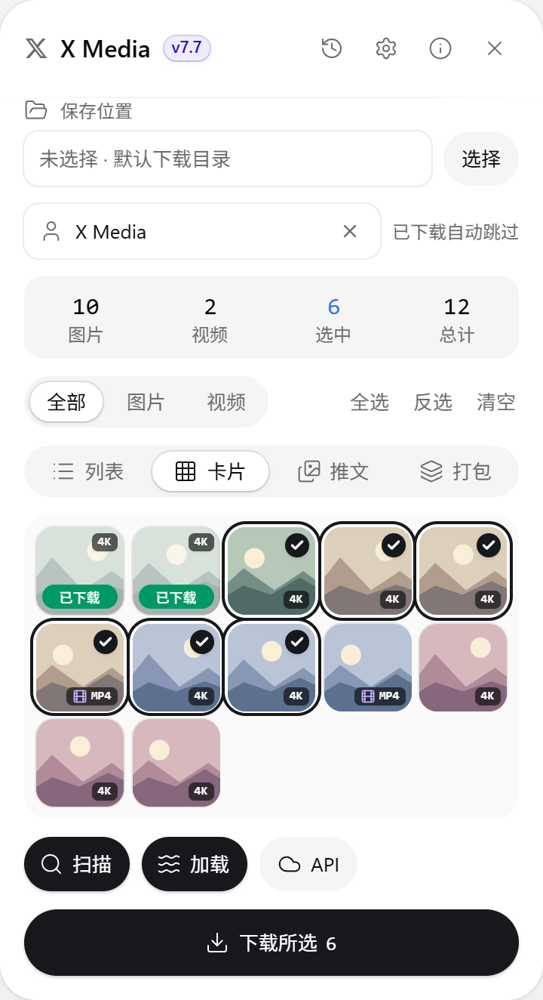
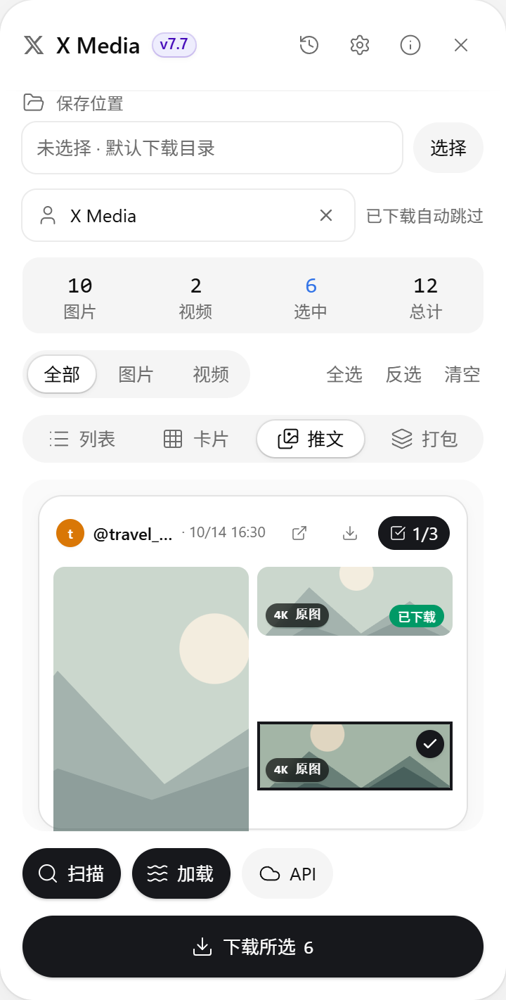

<div align="center">



**X / Twitter 图片与视频下载扩展**

单张原图 · 批量收集 · 已下载自动跳过 · 下载历史

[](https://github.com/hoangmaituan882-hue/x-media-downloader-extension/releases/download/v7.7.0/x-media-downloader-v7.7.0.zip)

[安装教程](#install) · [功能介绍](#features) · [常见问题](#faq) · [全部版本](https://github.com/hoangmaituan882-hue/x-media-downloader-extension/releases) · [更新记录](CHANGELOG.md)

**Chrome / Microsoft Edge** &nbsp; · &nbsp; **v7.7.0** &nbsp; · &nbsp; **下载后解压即可加载**

</div>

---

## 📦 先下载安装包

**[点击下载 x-media-downloader-v7.7.0.zip](https://github.com/hoangmaituan882-hue/x-media-downloader-extension/releases/download/v7.7.0/x-media-downloader-v7.7.0.zip)**

无需安装 Node.js，无需编译。安装包已经包含浏览器需要的扩展文件，以及可离线打开的中文安装说明。

解压后你会看到：

```text
📁 解压后的目录
├── 📁 X-Media-Downloader     ← 在浏览器中选择这个文件夹
│   ├── manifest.json
│   ├── content.js
│   ├── background.js
│   ├── styles.css
│   ├── icons/
│   └── …
└── 安装说明.html             ← 双击查看排版清晰的安装指南
```

> **认准 `manifest.json` 所在的文件夹。** 不要把 ZIP 文件或源码目录直接拖进浏览器。

<a id="install"></a>

## 🚀 安装只需几步

| 步骤 | 怎么做 |
| :---: | --- |
| **1 · 解压** | 下载上面的 ZIP，右键选择「全部解压」，把文件夹放到固定位置。 |
| **2 · 打开扩展页** | Chrome 地址栏输入 `chrome://extensions`；Edge 输入 `edge://extensions`。 |
| **3 · 加载** | 开启「开发者模式」→「加载已解压的扩展程序」→ 选择 **`X-Media-Downloader`** 文件夹。 |
| **4 · 开始使用** | 刷新 [x.com](https://x.com/)，点击浏览器工具栏里的扩展图标展开面板。 |

加载后请保留扩展文件夹，浏览器会持续从这个位置读取文件。

<details>
<summary><strong>以后更新版本怎么操作？</strong></summary>

1. 下载新版本安装包并解压。
2. 用新文件替换原来的 `X-Media-Downloader` 文件夹内容，**保持文件夹路径不变**。
3. 在扩展管理页点击「重新加载」，再刷新 X 页面。

这样可以沿用原扩展的设置与下载记录。

</details>

<a id="features"></a>

## ✨ 能做什么

| 想做的事 | 对应功能 |
| --- | --- |
| **看到一张就保存** | 悬停图片显示下载按钮，展开为「下载原图」；视频播放时也能下载。 |
| **一次整理很多媒体** | 扫描当前页面、自动滚动加载，或在博主媒体页通过 API 分页收集。 |
| **换一种方式查看** | 列表、卡片、推文、打包四种视图，支持同元素切换和悬停大图预览。 |
| **避免重复保存** | 单张下载与面板状态同步，已下载项自动标注并排除后续批量勾选。 |
| **文件保存有条理** | 按博主、月份或自定义目录分类，文件名支持发布日期、序号和推文文字。 |
| **找回之前的文件** | 历史统计、日期过滤、博主列表和独立画廊，支持补下载。 |
| **关注内容持续更新** | 配置订阅博主与检查间隔，定时收集新媒体并记录推送结果。 |

## 👀 界面预览

<table>
  <tr><th>卡片视图 · 一眼看清媒体</th><th>推文视图 · 同一条推文放在一起</th></tr>
  <tr><td align="center"></td><td align="center"></td></tr>
</table>

<sub>截图使用演示数据展示真实扩展界面。</sub>

## 🧭 第一次使用

**下载单张**：把鼠标移到 X 的图片或视频上，点击右上角下载按钮。

**批量保存**：进入博主的「媒体」页 → 点击「扫描」或「加载」→ 检查选择的媒体 → 点击「下载所选」。已下载的内容会自动跳过。

**加载更多**：「加载」会自动向下滚动。「API」适合在博主媒体页分页收集；首次使用时，先点击 X 页面上的「媒体」标签，等列表加载完成。

**调整保存方式**：通过面板设置文件名、文件夹策略、日期范围和并发数；下载历史在顶栏的历史入口查看。

<a id="faq"></a>

## 💬 常见问题

<details>
<summary><strong>提示「找不到清单文件」怎么办？</strong></summary>

确认已经完整解压，并选择能直接看到 `manifest.json` 的 `X-Media-Downloader` 文件夹。
如果下载的是 GitHub 的源码 ZIP，请选择解压后的 `dist/` 文件夹；页面顶部的即用安装包更省事。

</details>

<details>
<summary><strong>加载后没有出现面板？</strong></summary>

先刷新 X 页面，再点击浏览器工具栏中的扩展图标。如果面板折叠在角落，点击悬浮球展开。
扩展仅在 `x.com` 与 `twitter.com` 页面运行。

</details>

<details>
<summary><strong>文件保存在哪里？</strong></summary>

通常保存在浏览器的默认下载目录，可按设置创建子目录。
面板也提供文件夹选择入口；浏览器刷新后需要重新选择自定义文件夹。

</details>

<details>
<summary><strong>已经下载过的文件还能再下载吗？</strong></summary>

可以在下载历史中使用「补下载」找回文件。日常扫描和批量选择会自动跳过已保存项，避免重复下载。
主动清除下载记录后，对应媒体会重新变为可选状态。

</details>

<details>
<summary><strong>API 提示限频或没有捕获请求？</strong></summary>

限频时先暂停，稍后再试，也可以改用「加载」自动滚动。
未捕获请求时，先点击 X 页面上的「媒体」标签，等内容加载后再试。

</details>

<details>
<summary><strong>扩展为什么需要这些权限？</strong></summary>

- **存储**：保存设置、已下载记录和历史。
- **下载**：通过浏览器保存媒体文件。
- **标签页与定时任务**：按配置打开订阅博主页面、定时检查更新。
- **通知与右键菜单**：显示下载结果，提供图片右键下载入口。

</details>

---

## 🛠 开发与致谢

普通使用请下载上面的即用包。需要修改源码、运行测试或制作新版本，可阅读[开发说明](docs/DEVELOPMENT.md)与[测试说明](tests/README.md)。

使用 React 19、Motion、Tailwind CSS v4 与 Manifest V3 构建。动效组件基于 [beUI v2](https://github.com/starc007/ui-components)，详见[来源与适配记录](src/components/motion/ATTRIBUTION.md)。

<div align="center"><sub>把收藏留给内容，把整理交给工具。</sub></div>
